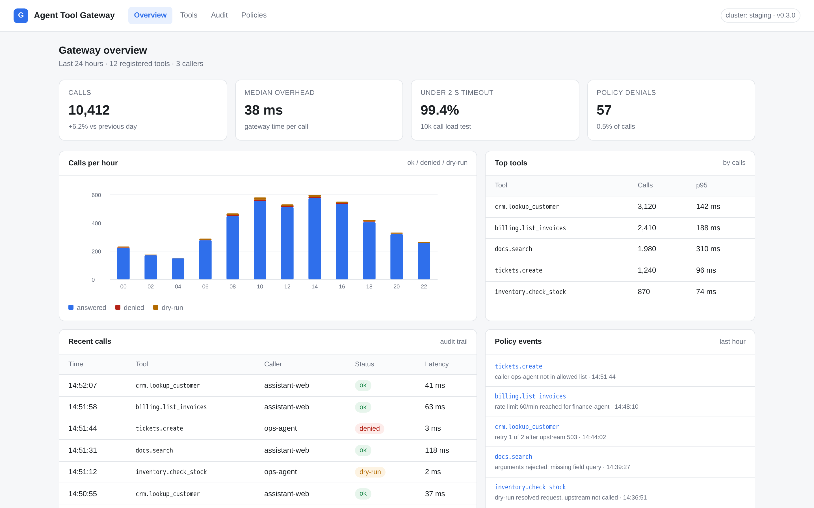
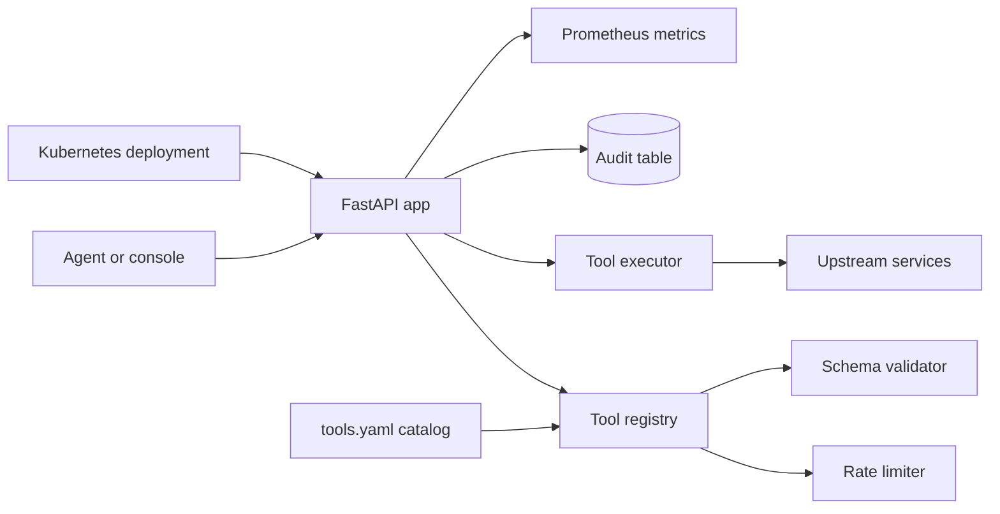

# Agent Tool Gateway

A small gateway that exposes internal services to LLM agents as typed, audited tools.



## Why

Wiring an assistant to an internal service usually means a folder of one-off scripts: a JSON schema here, a permission check there, a timeout nobody tuned, and a log line that is hard to query a week later. When a tool call fails silently in a demo, there is no single place to look. The gateway keeps tool definitions in one catalog, runs every call through a policy check and an audit table, and exposes the same behaviour on a laptop and in a cluster. It is for engineers who give agents access to real systems and need to see what those agents did.

## How it works

The catalog is a YAML file of tool specs. At start-up the app loads it into a registry, which holds a JSON Schema validator and a token-bucket rate limiter per tool. A call arrives at the API, is checked against the caller allow-list and the rate limit, has its arguments validated, and is then handed to the executor, which calls the upstream service with a timeout and a retry budget. Every outcome, including denials and invalid arguments, is written to the audit table and counted in Prometheus metrics.



## Key decisions

- The catalog is a YAML file rather than a database table, so a new tool is a reviewed pull request and a restart, at the cost of no hot reload.
- Policy lives in the registry, not in the upstream services, which keeps one place to read but means the gateway must know every caller name.
- Denials and invalid arguments are audited like successful calls, so the trail is complete, at the cost of rows that never reached a service.
- The audit store is plain SQLAlchemy over SQLite or PostgreSQL, which keeps local runs simple but leaves retention to the operator.

## Tech stack

- Python 3.11+ with FastAPI and uvicorn
- Pydantic models for tool specs and call results
- httpx for upstream calls, jsonschema for argument validation
- SQLAlchemy with SQLite or PostgreSQL for the audit table
- prometheus-client for metrics
- Docker image and a Kubernetes Deployment, Service and ConfigMap
- pytest, pytest-asyncio and respx for tests

## Quick start

Prerequisites: Python 3.11 or newer, and Docker if you want the image.

```bash
pip install -e ".[dev]"
python -m gateway.main
pytest
docker build -t agent-tool-gateway:0.3.0 .
kubectl apply -f deploy/k8s.yaml
```

| Variable | What it sets | Default |
| --- | --- | --- |
| `GATEWAY_DATABASE_URL` | SQLAlchemy URL of the audit store | `sqlite:///./gateway.db` |
| `GATEWAY_CATALOG_PATH` | Path to the YAML tool catalog | `catalog/tools.yaml` |
| `GATEWAY_REQUEST_TIMEOUT_S` | Default upstream timeout in seconds | `2.0` |
| `GATEWAY_LOG_LEVEL` | Log level for the process | `info` |

## Usage

```bash
curl -s -X POST http://127.0.0.1:8080/tools/call \
  -H 'content-type: application/json' \
  -d '{"tool": "invoice.list_open", "arguments": {"customer_id": "CUS-8841"}, "caller": "assistant"}'
```

```json
{
  "tool": "invoice.list_open",
  "status": "ok",
  "latency_ms": 41.7,
  "output": {"invoices": [{"id": "INV-1042", "total_cents": 18400, "status": "open"}]},
  "error": null,
  "audit_id": 1287
}
```

## Project structure

```text
gateway/     API, registry, executor, audit store, settings
catalog/     sample tool catalog
deploy/      Kubernetes manifests
tests/       registry and API tests
ui/          static dashboard page
```

## Limitations

- The catalog is read once at start-up; adding a tool needs a restart or a new pod.
- Rate limits are held in process memory, so each replica counts on its own.
- The audit table has no retention or export job yet.
- Upstream authentication is not handled; services are expected to accept calls from the gateway as they are.

## License

MIT. The project builds on FastAPI, SQLAlchemy and prometheus-client, each under its own licence.
